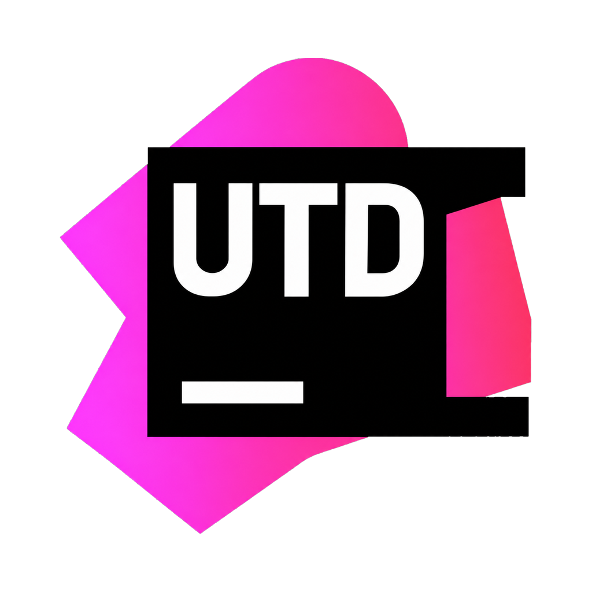
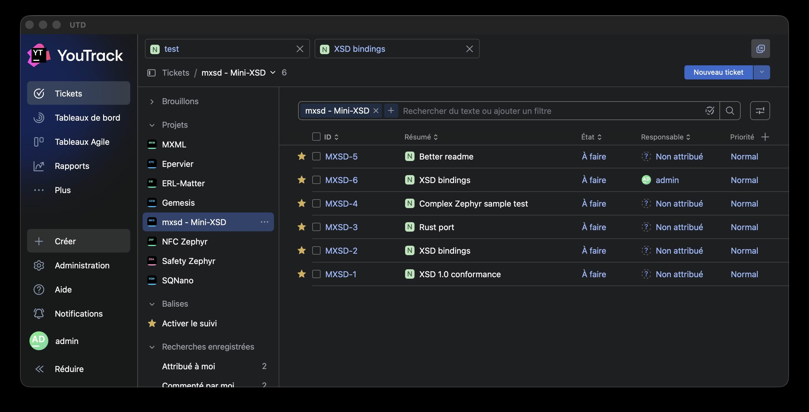
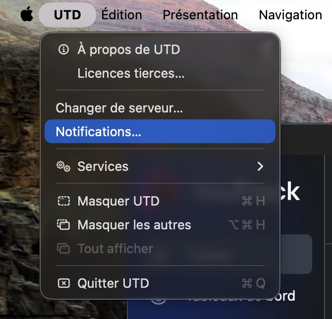
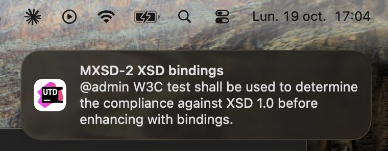
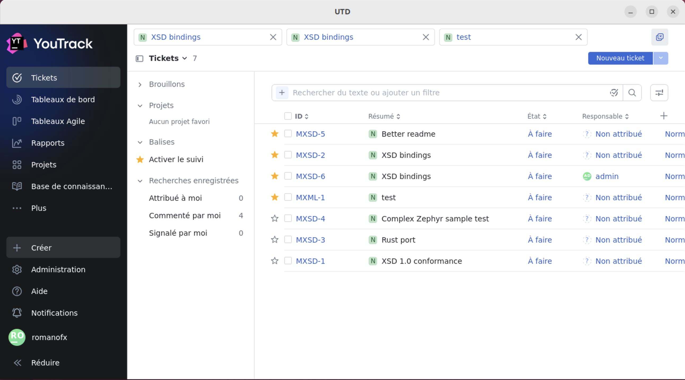
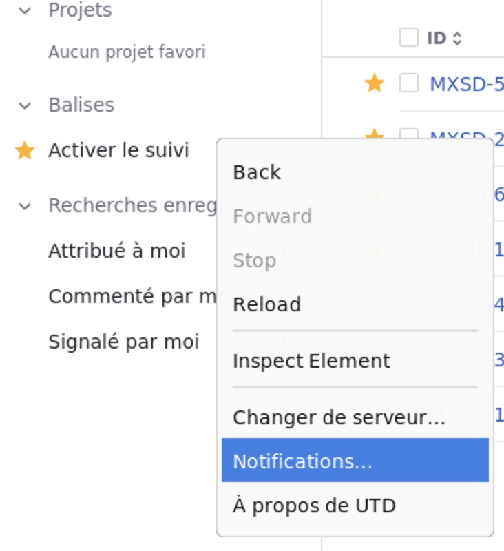
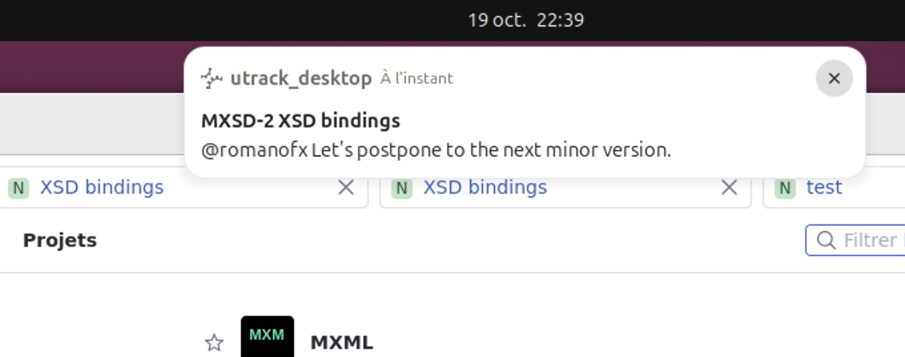
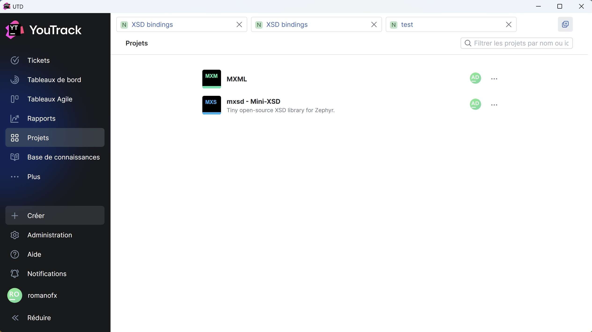
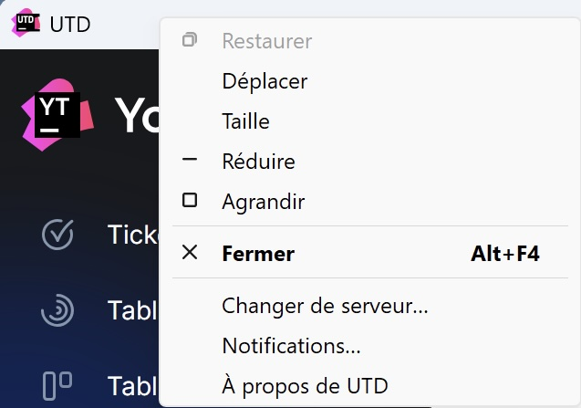
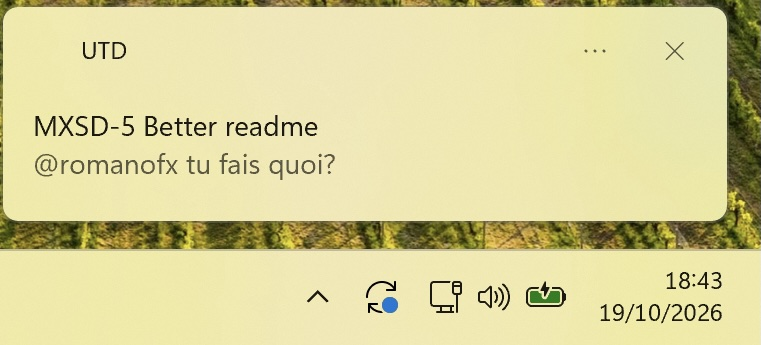

<p align="center">
  
</p>

# UTD — utrack-desktop

[](https://github.com/RomainPelletant/utrack-desktop/actions/workflows/ci.yml)
[](https://github.com/RomainPelletant/utrack-desktop/releases/latest)
[](LICENSE)

A Flutter desktop app that embeds a [YouTrack](https://www.jetbrains.com/youtrack/) instance.
 with notifications support.

> **UTD is not a JetBrains product.** YouTrack and JetBrains are trademarks or registered
> trademarks of JetBrains s.r.o. UTD is an independent project. It is not affiliated with,
> sponsored by, or endorsed by JetBrains. It only displays the web interface of a YouTrack
> instance you have access to.

## Features

- Embed YouTrack in an app (webview)
- Trigger YouTrack notifications (poll interval 90 seconds)
- Save YouTrack instance URL and notification token into protected storage
- Translated into 35 languages, the detected system language is applied automatically

# Screenshots

## MacOS

<p>
  
  
  
</p>

## Linux

<p>
  
  
  
</p>

## Windows

<p>
  
  
  
</p>

# Gettings started

On first launch, enter the server address. It is remembered, and YouTrack opens directly
on later launches.

Platforms: macOS, Windows, Linux.

| Action | macOS | Windows | Linux |
|---|---|---|---|
| Change server, Notifications…, About | **UTD** menu (and right-click in the page for "Change Server…") | window system menu (**Alt+Space** or right-click the title bar) | right-click in the page |
| Third-party licenses | **UTD → Third-Party Licenses…** | About → *View licenses* | About → *View licenses* |

# Notifications

**UTD → Notifications…**: enter a YouTrack permanent token (Profile › Account Security ›
New token, YouTrack scope). UTD then checks the YouTrack notification center every minute
(`/api/inbox/threads`, the API used by the YouTrack Mobile app), shows new notifications on
the desktop and the unread count on the Dock icon. Clicking a notification opens the issue
or article in the app.

The token is stored in the system vault (macOS Keychain, Windows Credential Manager,
libsecret on Linux), one per server. Leave the field empty to turn notifications off. On
macOS, closing the window keeps the app running so notifications keep coming; click the
Dock icon to reopen it. On Windows and Linux, closing the window quits the app, and there
is no unread badge.

# Releases

## MacOS

MacOS releases are notarized and signed using developer ID.
One universal release. (Intel-based and Apple silicon)

## Linux

Two Linux releases are provided:

- Binaries only
- Flatpak with dependencies (Recommanded to include WPE Webkit > 2.5)

ARM64 and AMD64 platforms are supported.

## Windows

Windows releases are provided as setup with MSVC14.
Only x86_64 platform is supported.


# Installation

## MacOS

Copy UTD.app into Applications folder

## Linux

Flatpak is recommended to bring WPE Webkit dependency.

```bash
apt install flatpak
flatpak install <UTD_release>.flatpak
```

## Windows

Launch installer <UTD_release>-setup.exe

# SBOM

Vulnerability scan is launched every monday on master branch.

# License

Copyright 2026 Romain Pelletant.

Licensed under the [Apache License 2.0](LICENSE) — see also [NOTICE](NOTICE). Dependency
licenses are listed in the app: **UTD → Third-Party Licenses…** on macOS, About → *View
licenses* on Windows and Linux.
YouTrack is a trademark of JetBrains s.r.o. UTD is an independent project and is neither affiliated with nor endorsed by JetBrains.

# Assistance

Development assisted by Claude code Opus 5.5.